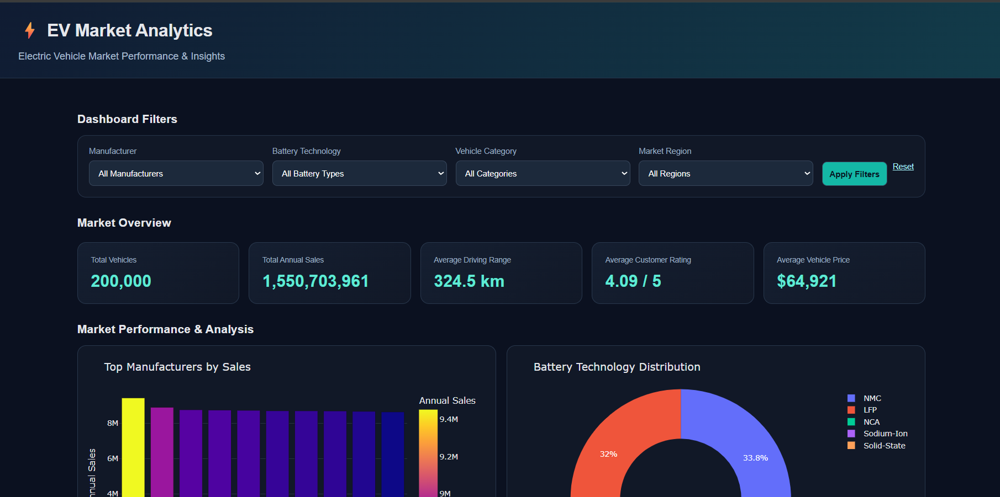

# ⚡ Electric Vehicle Market Performance & Insights

An interactive data analytics project that explores Electric Vehicle (EV) market trends using **Tableau, Python, Flask, Pandas, and Plotly**.

The project provides an interactive web dashboard to analyze manufacturer sales, battery technologies, vehicle categories, customer ratings, vehicle prices, and driving ranges.

## 📌 Project Overview

The Electric Vehicle Market Performance & Insights project transforms EV market data into meaningful business insights through interactive charts, visualizations, and key performance indicators (KPIs).

It includes:
- 📊 An interactive Tableau dashboard
- 🌐 A Python Flask web application
- 📈 Dynamic charts using Plotly
- 📉 Data analysis using Pandas
- 🔋 EV battery and performance analysis

## 🎯 Project Objectives

- Analyze annual EV sales by manufacturer.
- Compare battery technologies using battery cycle life.
- Explore sales distribution across vehicle categories.
- Understand customer rating patterns.
- Analyze vehicle prices against driving ranges.
- Present insights through interactive dashboards.

## ✨ Key Features

- **Interactive Dashboard:** Explore EV data through dynamic visualizations.
- **KPI Cards:** View total vehicles, annual sales, average price, and customer ratings.
- **Manufacturer Analysis:** Compare sales across EV manufacturers.
- **Battery Analysis:** Examine battery technologies and cycle life.
- **Category Analysis:** Understand sales distribution by vehicle category.
- **Customer Ratings:** Explore customer satisfaction patterns.
- **Price vs. Range:** Analyze the relationship between vehicle prices and driving range.
- **Dual Dashboards:** Explore insights through Tableau and Flask.

## 🖥️ Flask Web Dashboard Screenshots

### 1. Dashboard Overview



### 2. Manufacturer & Battery Analysis


### 3. Vehicle Price & Driving Range Analysis


## 📊 Tableau Dashboard

Explore the interactive Tableau dashboard for additional EV market insights.

**[View Tableau Dashboard](https://github.com/Aaditya-quantum/Electric-Vehicle-Market-Performance-Insights/blob/main/EV_Market_Performance%20%26%20Insights.twbx)**

> Download the Tableau packaged workbook from this repository to explore the dashboard in Tableau.

## 🛠️ Technologies Used

| Technology | Purpose |
|---|---|
| Python | Data processing and application logic |
| Flask | Web application framework |
| Pandas | Data analysis and manipulation |
| Plotly | Interactive charts |
| Tableau Public | Business intelligence and visualization |
| HTML & CSS | Dashboard interface |
| CSV | Dataset storage |
| GitHub | Version control and project hosting |

## 📂 Project Structure

```text
Electric-Vehicle-Market-Performance-Insights/
├── app.py
├── index.html
├── ev_market_test.csv
├── requirements.txt
├── README.md
├── Dashbord.png
├── Market performance analysis.png
├── Vehicle price vs drivinf range.png
└── EV_Market_Performance & Insights.twbx
```
## 🚀 Run the Project Locally

### Prerequisites

- Python 3
- pip package manager
- Git

### 1. Clone the repository

```bash
git clone https://github.com/Aaditya-quantum/Electric-Vehicle-Market-Performance-Insights.git
```

### 2. Open the project folder

```bash
cd Electric-Vehicle-Market-Performance-Insights
```

### 3. Install dependencies

```bash
pip install -r requirements.txt
```

### 4. Start the Flask application

```bash
python app.py
```

### 5. Open the dashboard

Visit the following URL in your browser:

```text
http://127.0.0.1:5000
```

## 📁 Dataset

The project uses the EV market dataset stored in `ev_market_test.csv`, included in this repository.

The dataset is used to explore available vehicle attributes, including manufacturer, battery specifications, vehicle categories, annual sales, vehicle prices, driving ranges, and customer ratings.


## 📈 Key Analyses

1. EV Manufacturer Sales Analysis
2. Battery Technology Analysis
3. Vehicle Category Analysis
4. Customer Ratings Analysis
5. EV Price and Driving Range Analysis

## 👨‍💻 Author

**Pari Chandwani**


---

⭐ If you find this project useful, consider giving the repository a star!

*Built to turn EV market data into actionable insights.*


